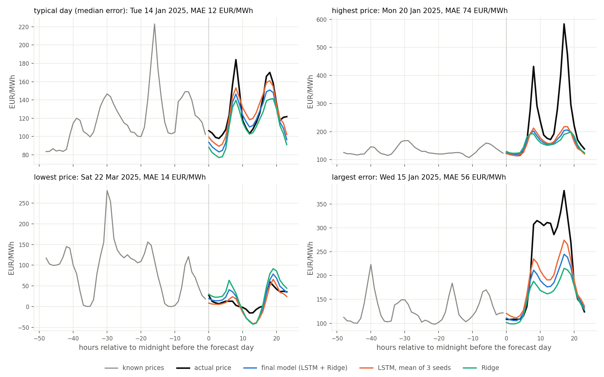
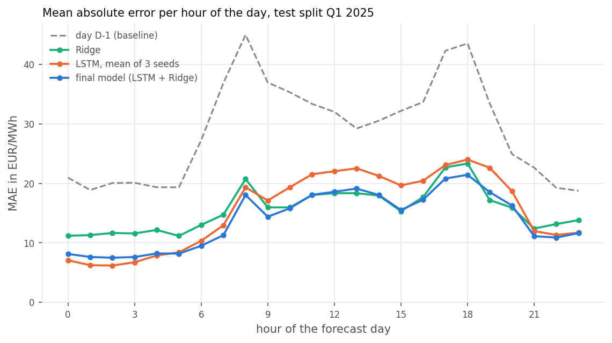

# Day-ahead forecast of the German electricity price

At 12:00 on the day before, the day-ahead auction sets the 24 hourly electricity prices of the next day. This project
forecasts these 24 prices for Germany with an ensemble of an LSTM and a linear model, and evaluates it once on a test
quarter that was not touched during development.

**Result on the test split (Q1 2025, 89 days): a mean absolute error of 13.9 €/MWh, half the error of repeating the
prices of the day before (29.0) and 11 % below a strong linear model (15.6), both significant (Diebold-Mariano,
p ≤ 0.0001).** The inputs of the forecast day (weather, wind, solar, residual load) are measured values used as
perfect forecasts, so the result is an upper bound for a forecast with real weather forecasts.



## Results

Test split Q1 2025, evaluated once (`reports/test_results.md`), errors in €/MWh:

| Forecast | MAE | RMSE | Median error | Hours within 10 / 20 €/MWh |
|---|---|---|---|---|
| Prices of the day before (day D-1) | 29.0 | 45.3 | 17.7 | 33 % / 54 % |
| Ridge regression | 15.6 | 24.8 | 11.7 | 43 % / 74 % |
| LSTM, mean of 3 seeds | 15.5 | 24.1 | 10.7 | 48 % / 73 % |
| **Final model: mean of LSTM and Ridge** | **13.9** | **22.9** | **9.5** | **52 % / 78 %** |



- **The two models are complementary.** The LSTM is much better at night (MAE 7.1 against 11.5 for 00:00 to 06:00),
  Ridge around midday when solar sets the price (18.4 against 21.5). Their mean beats both, the LSTM alone is no better
  than Ridge on the test split.
- **Single LSTMs are a gamble.** The three seeds of the same configuration reach 14.9, 15.6 and 17.2 on the test split.
  Averaging the seeds and Ridge made the result robust; this was decided on the validation split before the test.
- **Price spikes remain the limit.** Half of the hours are within 10 €/MWh, but days with scarcity spikes, such as the
  Dunkelflaute of December 2024 with up to 936 €/MWh, are underestimated by every model.

The validation quarter Q4 2024 was much more volatile: there the final model reaches 17.6 €/MWh against 37.9 for the
prices of the day before.

More analyses of the test split, such as the whole quarter hour by hour, the errors per weekday and price level, their
distribution and why the ensemble works, are in [notebooks/03_results.ipynb](notebooks/03_results.ipynb).

## The task

- **Forecast time:** 12:00 on day D-1, the closing time of the day-ahead auction.
- **Target:** the 24 hourly prices of day D. The two days per year with a clock change (23 or 25 hours) are skipped.
- **Known at forecast time:** all prices of D-1 (set in the auction on D-2); wind, solar, load and weather, also for
  the afternoon of D-1 and for day D, as perfect day-ahead forecasts. Values without a day-ahead forecast (e.g.
  conventional generation) would only be known until about 12:00 and are shifted by 12 hours; daily fuel prices by 24.

## Data

Hourly data from January 2023 to March 2025 (15-minute values averaged per hour): spot price, generation by source,
load, cross-border trade, installed capacities, gas, coal and CO₂ prices, and the mean wind speed and solar
irradiance. The dataset comes from a university course and is not part of this repository. Prices, generation and
load correspond to the public data of [SMARD.de](https://www.smard.de) (Bundesnetzagentur). To run the code, place it
at `data/raw/energy_ger.parquet`; `configs/data.toml` lists the expected columns.

On 26 June 2024 a technical failure decoupled the German market from the European day-ahead market coupling, and the
prices reached 2326 €/MWh without any scarcity behind them. New models leave this day out of their training targets
(`exclude_days` in `configs/lstm.toml`); the final model below was trained before this was found and includes it.

| Split | Forecast days | Days |
|---|---|---|
| Training | 2023-01-09 to 2024-09-30 | 628 |
| Validation | 2024-10-01 to 2024-12-31 | 91 |
| Test | 2025-01-01 to 2025-03-31 | 89 |

## Model

**Inputs.** The last 192 hours: spot price, its 7-day mean, solar and onshore/offshore wind generation, wind speed,
solar irradiance, solar capacity and utilization, residual load (load − wind − solar), Saturday, Sunday and the share of
the population with a public holiday, the gas, coal and CO₂ prices of the day before, and the hour of the day. For each
hour of day D: wind speed, solar irradiance, wind and solar generation, residual load and the calendar.

**LSTM.** Three LSTM layers with 256 units read the history. Their last state, layer-normalized, is concatenated with
the inputs of day D and passed through a hidden layer (256 units, GELU, dropout 0.5) to 24 outputs. The model
forecasts the deviation from the last known price, and its output layer starts at zero, so the untrained model
forecasts persistence. Huber loss, AdamW with learning rate 1e-3 and early stopping.

**Ridge.** A linear model on the prices of the last 168 hours, all inputs of the last hour and the inputs of day D,
with the regularization chosen by cross-validation on the training data.

**Final model.** The mean of the forecasts of the LSTM trained with three seeds and of Ridge, 50/50. For the test it
was retrained on training and validation data (17 epochs, the median best epoch of its validation runs).

## How it was developed

The full journal with all decisions and numbers is in [ROADMAP.md](ROADMAP.md). In short:

1. **Sanity checks** (`notebooks/02_sanity_checks.ipynb`) of the time alignment, an overfit test on a single batch,
   plots of single days and a check whether the model uses the inputs of day D.
2. **Every change was trained with 3 seeds** and counted only if the mean MAE improved by at least 0.5 €/MWh with all
   seeds better; the seed noise is 0.15 to 0.6 €/MWh. All decisions were made on the validation split.
3. **Training fixes** (higher learning rate with early stopping): 24.4 → 23.8 €/MWh on the validation split.
4. **Feature selection** (`scripts/select_features.py`): all 64 combinations of six feature groups, evaluated with Ridge
   and LightGBM in four rolling quarterly folds, then confirmed with the LSTM. Calendar, residual load, renewables and
   fuel prices: 23.6 → 18.7 €/MWh.
5. **Hyperparameter search** with Optuna (50 trials, `python -m spotforecast.tune`). The best trials confirmed with 3
   seeds were no better than the existing configuration, so it was kept.
6. **Ensemble** of the LSTM seeds and Ridge: 18.7 → 17.6 €/MWh. Frozen as the final model.
7. **One evaluation on the test split**, after a dry run of the same procedure on the validation split.

## Limitations

- **Perfect forecasts.** The weather, wind, solar and residual load of day D are measurements. With real day-ahead
  forecasts the errors would be larger; the next step would be the forecasts of the ENTSO-E Transparency Platform.
- **Spikes.** Scarcity spikes are not foreseen. Power plant outages and the neighbouring countries are not in the data.
- **Little data.** Two years of training data and a single test quarter; the result may differ in other seasons.
- **Point forecasts** without a statement of their uncertainty.

## Usage

```bash
conda env create -f environment.yml    # or: pip install -e ".[dev]"
conda activate spotforecast
# place the dataset at data/raw/energy_ger.parquet

python -m spotforecast.predict --date 2025-02-14 --plot   # the final model (models/final/) for one day
python -m spotforecast.train                              # one LSTM with configs/lstm.toml
python -m spotforecast.evaluate                           # the newest run against the baselines (validation split)
python -m spotforecast.evaluate --ensemble                # mean forecasts of the runs with the current features
python scripts/compare_runs.py                            # all runs of logs/experiments.csv, mean ± std per config
python scripts/select_features.py                         # feature selection with Ridge and LightGBM
python -m spotforecast.tune --trials 50                   # hyperparameter search
python -m spotforecast.final                              # final model on the test split (shows the existing report)
python scripts/make_figures.py                            # the figures of this README
python -m pytest tests                                    # tests against leakage
```

The final model can only forecast days of the dataset, because it needs the measured values of the forecast day.

## Repository

```
configs/          lstm.toml (model and training), data.toml (preprocessing, splits), feature_selection.toml
src/spotforecast/ data/ (preprocessing, features, windows), models/ (LSTM, baselines), train, evaluate, tune,
                  final, predict
scripts/          feature selection, run comparison, figures, model export, feature importance
notebooks/        sanity checks, results
models/final/     the three LSTMs of the final model
reports/          test results and figures
tests/            tests against leakage
```

## License

[MIT](LICENSE)
